# Лабораторна робота №2
## C4 Model та UML: статична структура і динамічна поведінка системи

**Дисципліна:** Проєктування архітектури, специфікація та стандарти інженерії<br>
**Тема проєкту:** E-Commerce Cloud Platform (High-Load Marketplace)<br>
**Виконав(ла):** О.В. Бєльченко<br>
**Група:** 3ПР1<br>
**Репозиторій:** https://github.com/Belckaa/Cloud-Platform<br>
**Git tag:** `lr2`

---

# 1. Мета роботи

Мета лабораторної роботи — описати архітектуру E-Commerce Cloud Platform за допомогою C4 Model та UML, побудувати діаграми статичної структури й динамічної поведінки, визначити протоколи взаємодії між контейнерами та перевірити можливість внесення змін до архітектурної документації.

# 2. Короткий опис системи

E-Commerce Cloud Platform — платформа електронної комерції для роботи з каталогом товарів, кошиком, замовленнями, оплатою та доставкою. Архітектура побудована як модульний моноліт із Clean Architecture. Такий підхід дає змогу розділити відповідальність між доменними модулями та адаптерами інфраструктури без штучного винесення кожного модуля в окремий мережевий сервіс.

Основний технологічний стек:
- Backend: Java 21, Spring Boot.
- Frontend: React, TypeScript.
- Основна база даних: PostgreSQL.
- Кешування: Redis.
- Асинхронний обмін повідомленнями: RabbitMQ.
- Ідентифікація та автентифікація: Keycloak.
- Контейнеризація й оркестрація: Docker, Kubernetes.
- Моніторинг: Prometheus, Grafana.

# 3. C4 Model

## 3.1. Level 1 — System Context

Діаграма System Context показує систему як єдине ціле та визначає її зовнішніх користувачів і системи, з якими вона взаємодіє.

Основні зовнішні актори та системи:
- Customer — покупець, який переглядає каталог і оформлює замовлення.
- Administrator — адміністратор платформи.
- Keycloak — система керування ідентифікацією та автентифікацією.
- Payment Gateway — зовнішній платіжний провайдер.
- Delivery Provider — зовнішній сервіс доставки.

Основні взаємодії з платформою виконуються через HTTPS. Для API використовується HTTPS/JSON, а для автентифікації — протоколи OIDC/OAuth2 поверх HTTPS.

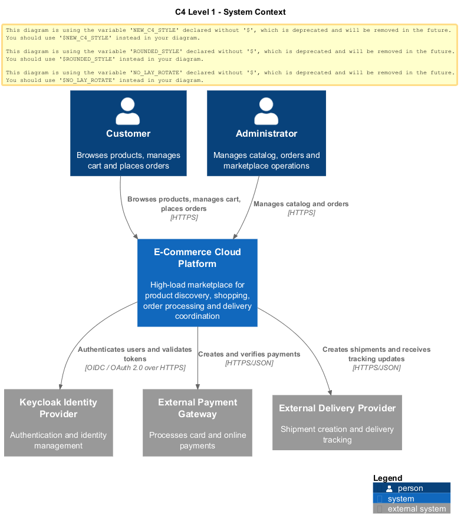

## 3.2. Level 2 — Container Diagram

Container Diagram деталізує програмні контейнери системи та протоколи їх взаємодії.

Основні контейнери:
- Web Application — клієнтський інтерфейс React/TypeScript.
- Backend Application — серверна частина Java 21/Spring Boot.
- PostgreSQL — постійне реляційне сховище.
- Redis — кешування результатів і швидкий доступ до тимчасових даних.
- RabbitMQ — брокер асинхронних повідомлень.
- Keycloak — керування обліковими записами та токенами.
- Notification Service — окремий контейнер для асинхронної обробки подій сповіщень.
- Prometheus/Grafana — збір і візуалізація метрик.
- Payment Gateway і Delivery Provider — зовнішні системи.

Протоколи взаємодії:
- Web Application → Backend Application: HTTPS/JSON.
- Backend Application → Keycloak: HTTPS/JSON, OIDC.
- Backend Application → PostgreSQL: TCP/IP, порт 5432.
- Backend Application → Redis: TCP/IP, порт 6379.
- Backend Application → RabbitMQ: AMQP 0-9-1 поверх TCP/IP, порт 5672.
- RabbitMQ → Notification Service: AMQP 0-9-1 поверх TCP/IP, порт 5672.
- Backend Application → Payment Gateway і Delivery Provider: HTTPS/JSON.
- Prometheus → Backend Application: HTTP/TCP/IP для отримання метрик.

Оскільки основна Backend Application є модульним монолітом, внутрішня взаємодія її модулів не потребує окремого мережевого протоколу. Асинхронний обмін із Notification Service відбувається через RabbitMQ.

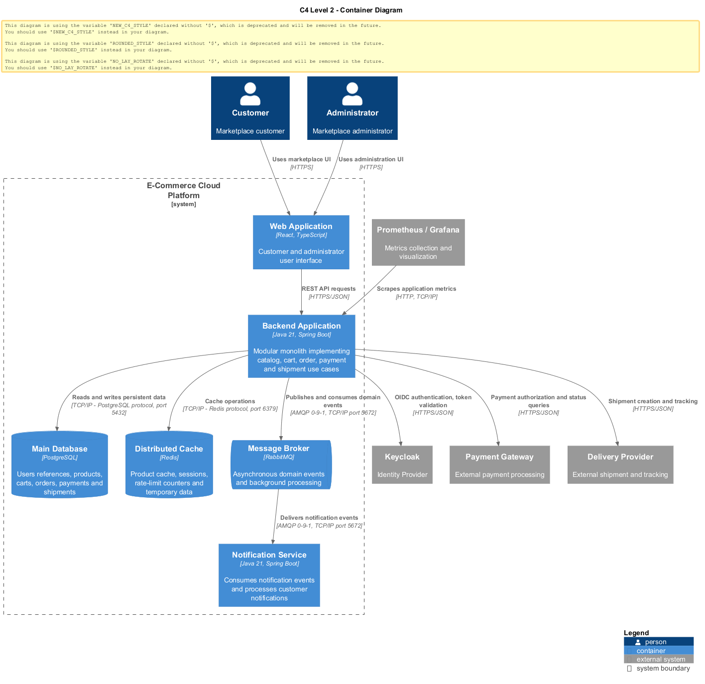

# 4. UML Static Structure

## 4.1. UML Component Diagram

Діаграма компонентів деталізує Backend у контексті обробки замовлень.

Основні компоненти:
- Order REST Controller;
- Place Order Use Case;
- Order Query Use Case;
- Order Domain Service;
- Order Repository Adapter;
- Payment Adapter;
- Inventory Adapter;
- Event Publisher Adapter.

Provided interfaces описують функції, які компонент надає іншим компонентам. Required interfaces показують залежності, необхідні компоненту для роботи. У моделі розглядаються `IOrderAPI`, `IOrderQuery`, `IOrderRepository`, `IPaymentGateway`, `IInventoryService` та `IEventPublisher`.

Controller приймає зовнішні запити. Use Case координує бізнес-операцію, Domain Service реалізує доменні правила, а адаптери забезпечують взаємодію з інфраструктурою.

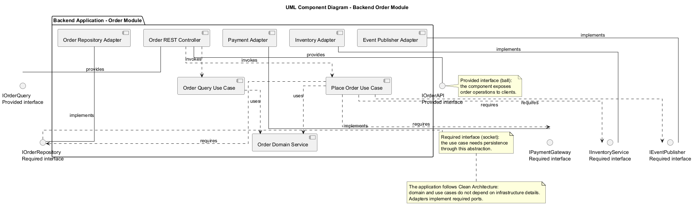

## 4.2. UML Domain Class Diagram

Діаграма доменних класів моделює основні сутності електронної комерції:

| Клас | Призначення |
|---|---|
| Customer | Покупець |
| Product | Товар |
| Cart | Кошик |
| CartItem | Позиція кошика |
| Order | Замовлення |
| OrderItem | Позиція замовлення |
| Payment | Платіж |
| Shipment | Відправлення |

У діаграмі визначено атрибути, методи, типи даних, специфікатори видимості `+` (public), `-` (private), `#` (protected) та кратність зв'язків.

Композиція використана для зв'язків Cart—CartItem і Order—OrderItem, оскільки позиції є складовими відповідних об'єктів. Product існує незалежно від кошика або замовлення, тому зв'язок із ним подано як асоціацію. Order також пов'язаний із Payment та Shipment.

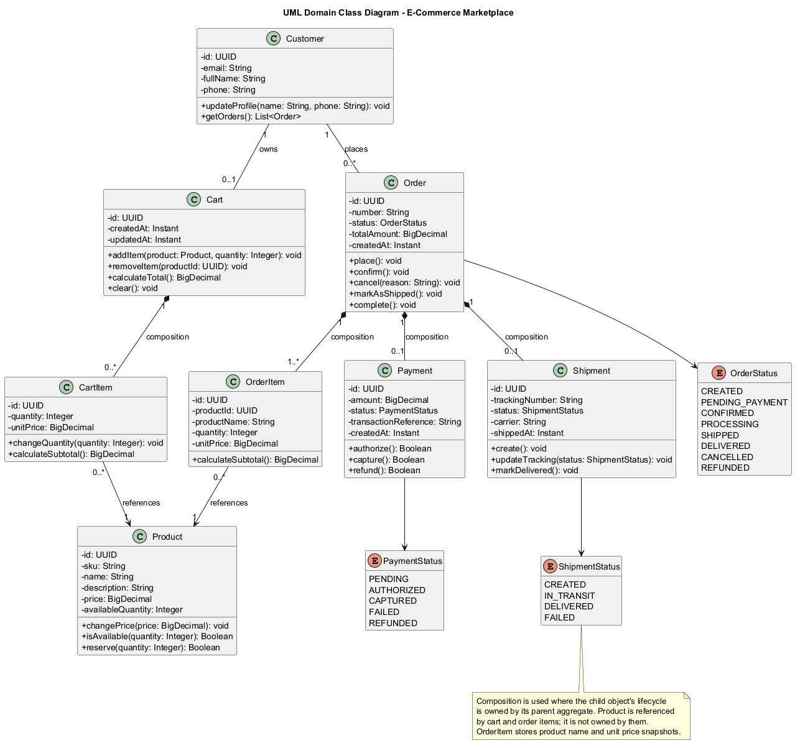

# 5. UML Dynamic Behavior

## 5.1. Sequence Diagram — Order Placement

Діаграма послідовності відображає оформлення замовлення. Учасники сценарію: Customer, Web Application, Backend API, Order Service, Inventory, Payment Gateway та Database.

Основна послідовність:
1. Користувач ініціює оформлення замовлення.
2. Backend перевіряє запит і токен автентифікації.
3. Система перевіряє наявність товарів.
4. Створюється замовлення.
5. Виконується авторизація платежу.
6. Результат операції зберігається.
7. Користувач отримує результат.

Використані оператори:
- `alt` — альтернативні результати перевірки токена, наявності товарів і платежу;
- `loop` — повторна обробка позицій замовлення;
- `opt` — необов'язкова операція перегляду деталей.

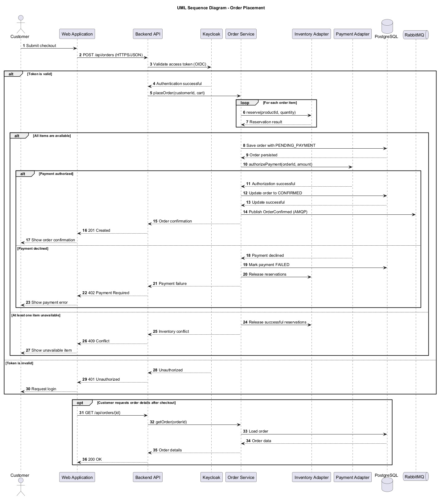

## 5.2. Sequence Diagram — Authentication and Product Search

Діаграма демонструє пошук товарів і перевірку автентифікації під час доступу до захищеного ресурсу.

Пошук використовує Redis для перевірки кешу. Якщо результат є в кеші, система повертає його без звернення до бази даних. Якщо кеш не містить потрібних даних, Catalog виконує запит до PostgreSQL і зберігає результат у Redis.

Для захищеного сценарію перевіряється токен:
- за валідного токена Backend повертає `200 OK`;
- за недійсного або простроченого токена Backend повертає `401 Unauthorized`, після чого Web Application перенаправляє користувача на сторінку входу.

Також використано `opt` для необов'язкової нормалізації пошукового запиту та `loop` для повторного пошуку зі зміненими фільтрами.

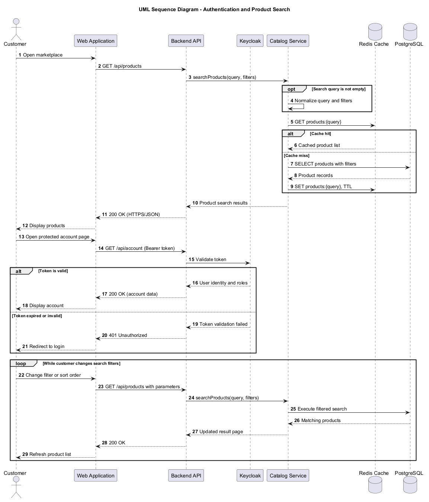

# 6. UML State Machine Diagram

Діаграма станів описує життєвий цикл замовлення. Основні стани:
1. `Created` — замовлення створене.
2. `PendingPayment` — очікується оплата.
3. `Confirmed` — оплату підтверджено.
4. `Processing` — замовлення обробляється.
5. `Shipped` — замовлення відправлене.
6. `Delivered` — замовлення доставлене.
7. `Cancelled` — замовлення скасоване.
8. `Refunded` — кошти повернені.

Переходи між станами визначаються результатом оплати, наявністю товарів, виконанням операцій обробки та доставкою. Діаграма дає змогу перевірити допустимі переходи та уникати некоректних змін стану замовлення.

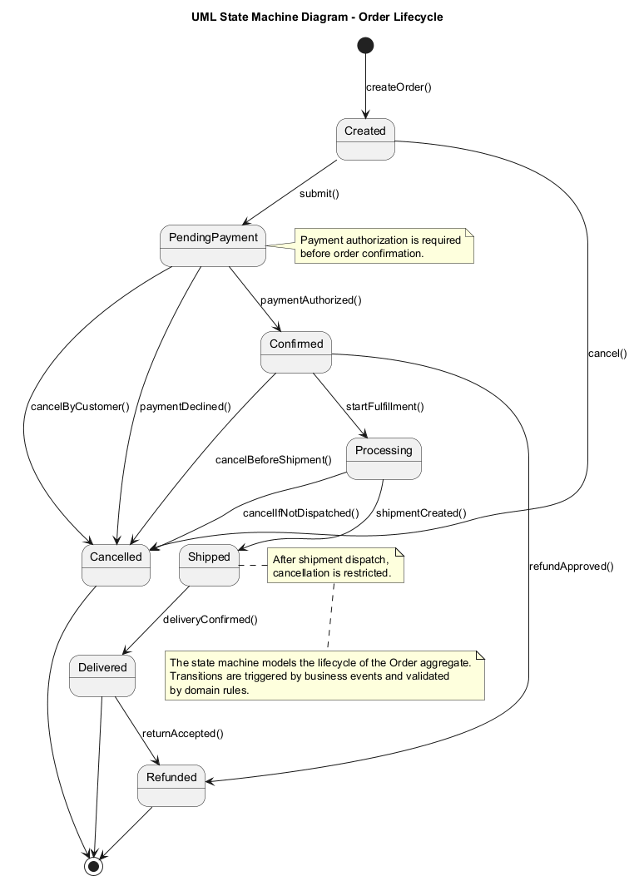

# 7. Модифікаційне тестування

## 7.1. Додавання Notification Service

До C4 Container Diagram додано окремий контейнер Notification Service на базі Java 21 та Spring Boot. Сервіс отримує події сповіщень через RabbitMQ. Для передавання повідомлень використовується AMQP 0-9-1 поверх TCP/IP, порт 5672.

Це дає змогу обробляти сповіщення асинхронно та зменшує залежність основного процесу оформлення замовлення від операцій надсилання повідомлень.

## 7.2. Альтернативна гілка 401 Unauthorized

У Sequence Diagram автентифікації передбачено альтернативну гілку для недійсного або простроченого токена. Якщо токен валідний, Backend API повертає `200 OK`. Якщо токен недійсний або прострочений, Backend API повертає `401 Unauthorized`, а Web Application перенаправляє користувача на сторінку входу. Альтернативні сценарії оформлено оператором `alt`.

## 7.3. Результати перевірки

| Перевірка | Результат |
|---|---|
| Додавання Notification Service до C4 Container Diagram | Виконано |
| Зв'язок RabbitMQ → Notification Service | Виконано |
| Вказання AMQP 0-9-1, TCP/IP, порт 5672 | Виконано |
| Альтернативна гілка `401 Unauthorized` | Перевірено у вихідному коді |
| Повторний рендеринг діаграм | Виконано скриптом |

# 8. Відповіді на контрольні питання

## 8.1. У чому полягає різниця між C4 Model та UML?

C4 Model — підхід до опису архітектури програмної системи на кількох рівнях абстракції: System Context, Container, Component та Code. UML — стандартизована мова моделювання, яка містить різні типи діаграм для опису структури та поведінки системи. C4 допомагає послідовно пояснити архітектуру від загального контексту до внутрішньої структури, а UML надає формальні засоби моделювання класів, компонентів, взаємодій і станів.

## 8.2. Чим відрізняється синхронна REST/gRPC взаємодія від асинхронної AMQP/Kafka?

REST і gRPC зазвичай використовуються для синхронної взаємодії: клієнт надсилає запит і очікує відповідь. AMQP та Kafka підтримують асинхронну взаємодію через обмін повідомленнями або подіями. Відправник не повинен очікувати завершення обробки повідомлення отримувачем. У цій архітектурі HTTPS/JSON використовується для API-запитів, а RabbitMQ та AMQP — для асинхронних подій.

## 8.3. Що означають Provided та Required Interfaces у UML Component Diagram?

Provided Interface — інтерфейс, який компонент реалізує та надає іншим компонентам. Required Interface — інтерфейс, який компонент використовує та потребує для своєї роботи. У стандартній нотації ball позначає наданий інтерфейс, а socket — необхідний інтерфейс.

## 8.4. Чим відрізняється агрегація від композиції?

Агрегація — слабкий зв'язок «ціле—частина», за якого частина може існувати незалежно від цілого. Композиція — сильний зв'язок, за якого життєвий цикл частини залежить від життєвого циклу цілого. Наприклад, OrderItem належить конкретному Order і моделюється композицією. Product існує незалежно від замовлення, тому зв'язок із ним є асоціацією.

## 8.5. У чому різниця між операторами alt, opt та loop?

- `alt` — задає альтернативні гілки виконання залежно від умови.
- `opt` — описує необов'язковий фрагмент, який виконується за певної умови.
- `loop` — задає повторення фрагмента взаємодії.

У роботі `alt` використовується для результатів автентифікації та оплати, `opt` — для необов'язкових операцій, а `loop` — для обробки позицій замовлення та повторного пошуку.

# 9. Висновки

У результаті лабораторної роботи побудовано архітектурне представлення E-Commerce Cloud Platform із використанням C4 Model та UML. Створено діаграми System Context, Container, Component, Domain Class, дві Sequence Diagram і State Machine. Описано контейнери системи, технології та протоколи взаємодії, компоненти Backend, доменні сутності й поведінку замовлення.

Виконано модифікаційні перевірки: додано Notification Service до C4 Container Diagram та перевірено альтернативну гілку `401 Unauthorized` у Sequence Diagram. Діаграми створені як код PlantUML, що дає змогу зберігати їх у системі контролю версій і повторно генерувати зображення після змін.

# 10. Структура матеріалів

```text
docs/
├── architecture_diagrams_report.md
└── diagrams/
    ├── 01_system_context.puml
    ├── 02_container_diagram.puml
    ├── 03_backend_components.puml
    ├── 04_domain_class_diagram.puml
    ├── 05_order_sequence.puml
    ├── 06_auth_search_sequence.puml
    ├── 07_order_state_machine.puml
    └── rendered/
        ├── 01_system_context.png
        ├── 02_container_diagram.png
        ├── 03_backend_components.png
        ├── 04_domain_class_diagram.png
        ├── 05_order_sequence.png
        ├── 06_auth_search_sequence.png
        └── 07_order_state_machine.png
```

# ДОДАТОК А. Вихідний код PlantUML

Нижче наведено повний вихідний код семи діаграм. Джерелом є відповідні файли каталогу `docs/diagrams/`.

## 01_system_context.puml

```plantuml
@startuml 01_system_context
!includeurl https://raw.githubusercontent.com/plantuml-stdlib/C4-PlantUML/master/C4_Context.puml

title C4 Level 1 - System Context
LAYOUT_WITH_LEGEND()

Person(customer, "Customer", "Browses products, manages cart and places orders")
Person(admin, "Administrator", "Manages catalog, orders and marketplace operations")

System(platform, "E-Commerce Cloud Platform", "High-load marketplace for product discovery, shopping, order processing and delivery coordination")

System_Ext(keycloak, "Keycloak Identity Provider", "Authentication and identity management")
System_Ext(payment, "External Payment Gateway", "Processes card and online payments")
System_Ext(delivery, "External Delivery Provider", "Shipment creation and delivery tracking")

Rel(customer, platform, "Browses products, manages cart, places orders", "HTTPS")
Rel(admin, platform, "Manages catalog and orders", "HTTPS")
Rel(platform, keycloak, "Authenticates users and validates tokens", "OIDC / OAuth 2.0 over HTTPS")
Rel(platform, payment, "Creates and verifies payments", "HTTPS/JSON")
Rel(platform, delivery, "Creates shipments and receives tracking updates", "HTTPS/JSON")

SHOW_LEGEND()
@enduml
```

## 02_container_diagram.puml

```plantuml
@startuml 02_container_diagram
!includeurl https://raw.githubusercontent.com/plantuml-stdlib/C4-PlantUML/master/C4_Container.puml

title C4 Level 2 - Container Diagram
LAYOUT_WITH_LEGEND()

Person(customer, "Customer", "Marketplace customer")
Person(admin, "Administrator", "Marketplace administrator")

System_Boundary(platform, "E-Commerce Cloud Platform") {
    Container(web, "Web Application", "React, TypeScript", "Customer and administrator user interface")
    Container(api, "Backend Application", "Java 21, Spring Boot", "Modular monolith implementing catalog, cart, order, payment and shipment use cases")
    ContainerDb(db, "Main Database", "PostgreSQL", "Users references, products, carts, orders, payments and shipments")
    ContainerDb(cache, "Distributed Cache", "Redis", "Product cache, sessions, rate-limit counters and temporary data")
    ContainerQueue(broker, "Message Broker", "RabbitMQ", "Asynchronous domain events and background processing")
    Container(notification, "Notification Service", "Java 21, Spring Boot", "Consumes notification events and processes customer notifications")
}

System_Ext(identity, "Keycloak", "Identity Provider")
System_Ext(payment, "Payment Gateway", "External payment processing")
System_Ext(delivery, "Delivery Provider", "External shipment and tracking")
System_Ext(monitoring, "Prometheus / Grafana", "Metrics collection and visualization")

Rel(customer, web, "Uses marketplace UI", "HTTPS")
Rel(admin, web, "Uses administration UI", "HTTPS")
Rel(web, api, "REST API requests", "HTTPS/JSON")
Rel(api, identity, "OIDC authentication, token validation", "HTTPS/JSON")
Rel(api, db, "Reads and writes persistent data", "TCP/IP - PostgreSQL protocol, port 5432")
Rel(api, cache, "Cache operations", "TCP/IP - Redis protocol, port 6379")
Rel(api, broker, "Publishes and consumes domain events", "AMQP 0-9-1, TCP/IP port 5672")
Rel(broker, notification, "Delivers notification events", "AMQP 0-9-1, TCP/IP port 5672")
Rel(api, payment, "Payment authorization and status queries", "HTTPS/JSON")
Rel(api, delivery, "Shipment creation and tracking", "HTTPS/JSON")
Rel(monitoring, api, "Scrapes application metrics", "HTTP, TCP/IP")

SHOW_LEGEND()
@enduml
```

## 03_backend_components.puml

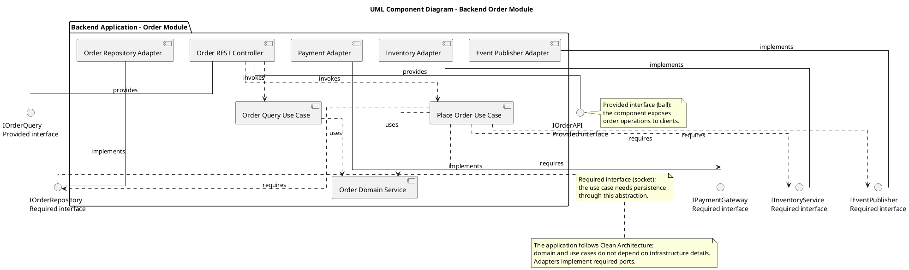

## 04_domain_class_diagram.puml

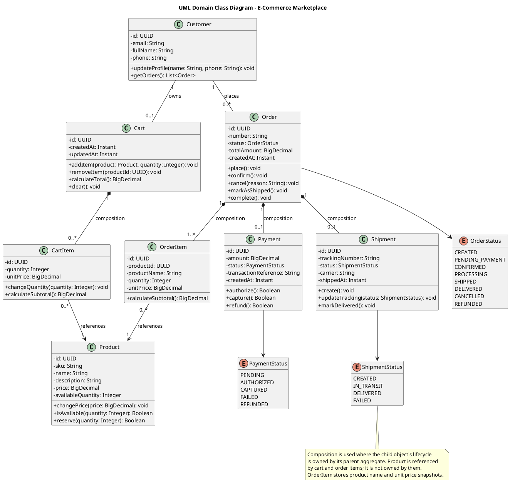

## 05_order_sequence.puml

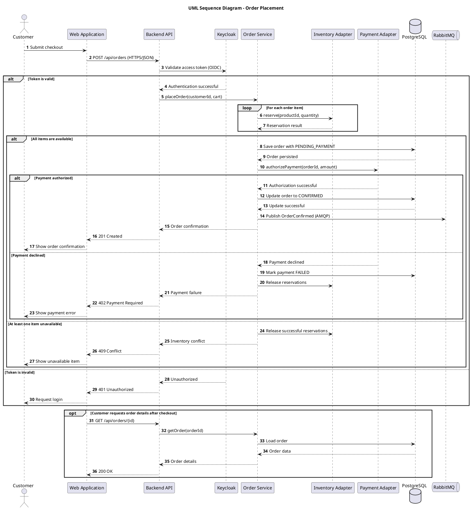

## 06_auth_search_sequence.puml

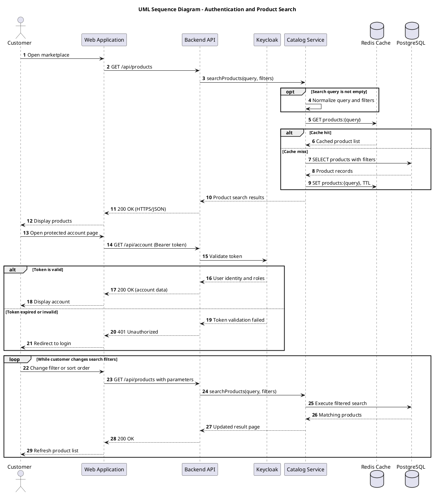

## 07_order_state_machine.puml

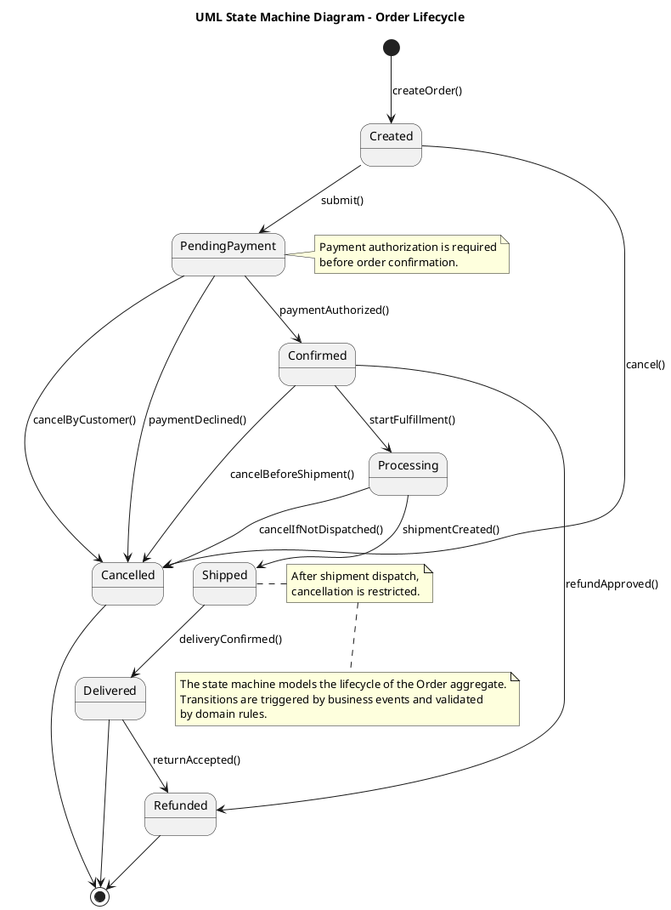
